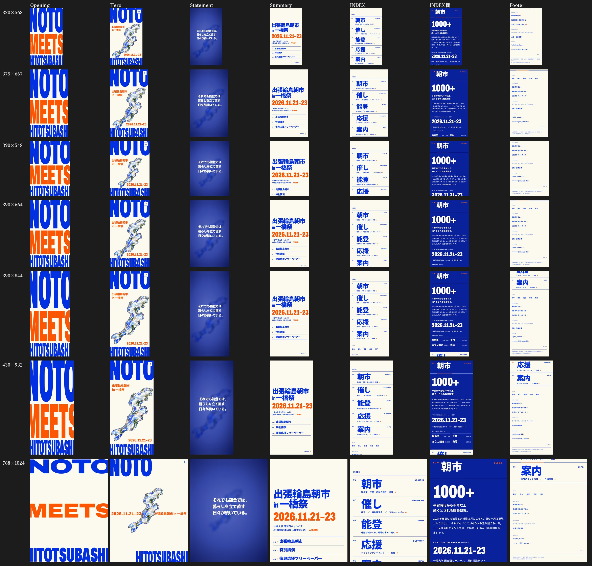

# 出張輪島朝市 in 一橋祭 Webサイト

NOTO meets HITOTSUBASHI — 一橋祭で開催する「出張輪島朝市」の告知サイトです。



## 概要

| 項目 | 内容 |
|---|---|
| イベント名 | 出張輪島朝市 in 一橋祭 |
| 開催日 | 2026年11月21日（土）〜23日（月・祝）　一橋祭 会期中・3日間 |
| 開催場所 | 一橋大学 国立西キャンパス（屋外広場・教室／東京都国立市中2-1） |
| アクセス | JR中央線 国立駅 南口から徒歩約10分 |
| 主催 | 能登を応援する一橋有志の会 |
| 特別協力 | 輪島朝市を応援する会 |
| サイトの目的 | 能登の「いま」を東京へ伝え、出張輪島朝市・特別講演・復興応援フリーペーパーの3企画へ来場と応援を呼びかけること |

## 現在の状態（2026年10月10日）

- **Desktop / Laptop**：実装済み（幅 約1024〜1920px。1024×768・1280×720・1366×768・1440×900・1512×982・1728×1117・1920×1080 で確認）
- **スマートフォン（縦向き）**：実装済み。Opening から Footer まで縦長画面用に組み直してあります（320×568・375×667・390×548・390×664・390×844・430×932 で確認）
- **タブレット縦向き（768×1024 付近）**：Statement 以降はスマホ版の構成。Hero は PC 版の構図
- **スマホ横向き**：PC 版の構図で表示（横スクロールは出ない）
- **リンク**：内部・外部リンクはすべて動作。**CAMPFIRE（クラウドファンディング）の URL だけ未確定**で、押せない文字表示（→ `LINKS.md`）
- **ブラウザ**：Chrome / Safari の最新版を想定。確認は Chromium で実施。**iPhone Safari 実機での最終確認を推奨**

## 手元で確認する

ビルド作業はありません。リポジトリのファイルがそのまま公開ファイルです。

```
npm run dev        # Node.js 18 以上。追加パッケージなし（npm install 不要）
```

→ ブラウザで `http://localhost:5173/` を開く。止めるときは `Ctrl + C`。

Node.js がない場合：このフォルダで `python3 -m http.server 5173` → `http://localhost:5173/`

> ⚠️ `index.html` をダブルクリックで開く方法では動きません（ES モジュールと WebGL がブラウザに止められます）。必ずサーバー経由で開いてください。

## 公開する

静的ファイルだけなので、どのホスティングでもリポジトリの中身をそのまま置けば動きます。

- **GitHub Pages**：リポジトリの Settings → Pages → Source を「Deploy from a branch」、Branch を `main` / `/ (root)` にして保存。数分で `https://<ユーザー名>.github.io/noto-website/` で公開されます（`.nojekyll` 同梱済み）
- **Netlify / Vercel / Cloudflare Pages**：このリポジトリを連携し、ビルドコマンドなし・公開フォルダはルート（`/`）

## 編集するときによく触る場所

| 変えたいもの | ファイル | 探し方 |
|---|---|---|
| Statement（3つの文章） | `index.html` | `EDIT: Statement`（PC用 `.l.d` とスマホ用 `.l.m` の改行が別々にあります） |
| Event Summary（タイトル・日付・3企画） | `index.html` | `EDIT: Event Summary` |
| INDEX 01〜05 の中身 | `index.html` | `EDIT: 01 朝市` 〜 `EDIT: 05 案内（開催情報）` |
| 外部リンク・SNS | `index.html` | `EDIT: フッター`（一覧は `LINKS.md`） |
| クラウドファンディング（CAMPFIRE） | `index.html` | `cta-na`（04 応援）と `URL未設定`（フッター）。差し替え方法は `LINKS.md` |
| Hero のオレンジの日付・タイトル | `scripts/hero.js` | PC：`const REST`、スマホ：`const MOB` の `REST`（`titleA` `titleB` `date`） |
| 色 | `styles/site.css` | 先頭の `:root`（`--paper` `--cobalt` `--deep` `--orange`）。WebGL 側は `scripts/hero.js` 先頭の `COBALT` `ORANGE` `CREAM` |
| スマホ版のレイアウト | `styles/site.css` | `PHONE + PORTRAIT TABLET` のブロック（`@media (max-width: 1023px) and (orientation: portrait)`） |
| ページのタイトル・説明文 | `index.html` | 先頭の `<title>` と `<meta name="description">` |

> Statement の文章を変える場合は、フォントの読み込み範囲も更新が必要です → `HANDOFF.md` §4

## フォルダ構成

```
noto-website/
├─ README.md          ← このファイル
├─ HANDOFF.md         ← 引き継ぎ書（構成・色・フォント・Liquid Object・スマホ版の仕組み・性能・未確定事項）
├─ LINKS.md           ← 全リンク一覧
├─ index.html         ← 文言・構造
├─ styles/site.css    ← 見た目（PC → スマホ／タブレット縦 → スマホ横 の順）
├─ scripts/
│   ├─ main.js        ← スクロール演出・Statement・INDEX アコーディオン・リンク動作
│   ├─ hero.js        ← Opening / Hero / Liquid Object（WebGL）。PC とスマホの2つの構図
│   └─ field.js       ← マウス位置の受け取り（Liquid Object 用）
├─ assets/            ← Liquid Object の画像素材と数値（assets.json）
├─ vendor/three/      ← 3D 描画ライブラリ three.js r180（MIT ライセンス、同梱）
├─ tools/serve.mjs    ← 手元確認用サーバー（npm run dev）
├─ docs/screenshots/  ← 見た目の基準画像
├─ package.json
└─ .nojekyll          ← GitHub Pages 用
```
